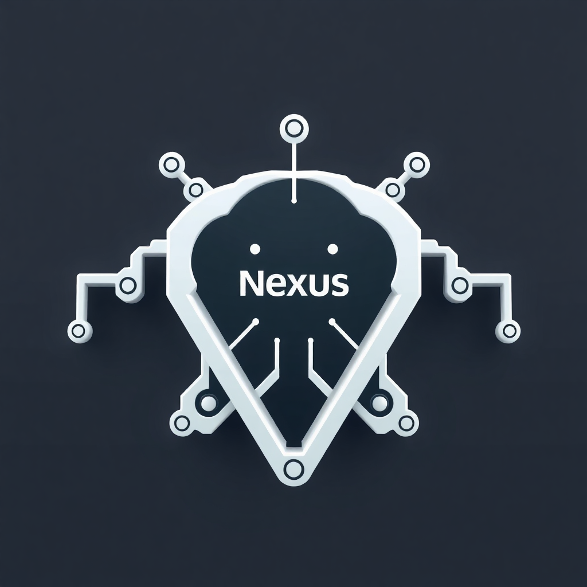

# Nexus

**One bot for your Discord server and your Twitch chat, with a web dashboard to set up both.**

[Website](https://nexus.nerdscode.dev) ·
[Add to Discord](https://discord.com/oauth2/authorize?client_id=YOUR-CLIENT-ID&permissions=8&scope=bot+applications.commands) ·
[Dashboard](https://nexus.nerdscode.dev/dashboard) ·
[Docs](https://nexus.nerdscode.dev/docs) ·
[Support server](https://discord.gg/ph8WmyuQRR)

---

## What Nexus does

### On Discord

- **Moderation** — warn, time out, kick and ban, with a numbered case for every action
- **Server logs** — message edits and deletions, joins, leaves and role changes, with ghost pings flagged
- **Tickets** — private support channels with your staff, and a transcript of every ticket
- **Role pickers** — let members choose their own roles from a menu
- **Giveaways** — with required roles and minimum time in the server
- **Twitch live notifications** — announce when any streamer goes live
- **Status updates** — incidents from Discord, GitHub, Twitch and MongoDB Atlas posted to your channels
- **Games and lookups** — Tic-Tac-Toe, Connect 4, Who's That Pokémon, weather, movies, translation and more

Nexus speaks 10+ languages on Discord and replies in each member's own language.

### On Twitch

- **Chat alerts** — thank viewers for follows, subs, gift subs, Bits, raids and channel point redemptions
- **Chat filters** — links, caps, emote spam and blocked words, with link permits for trusted viewers
- **Custom commands** — your own `!commands` with cooldowns and placeholders
- **Giveaways** — viewers type `!enter`, and subscribers get extra entries
- **Moderator tools** — chat modes, bans and timeouts from the dashboard

## Get started

1. **Discord:** [add Nexus to your server](https://discord.com/oauth2/authorize?client_id=YOUR-CLIENT-ID&permissions=8&scope=bot+applications.commands), then run `/setup`.
2. **Twitch:** sign in to the [dashboard](https://nexus.nerdscode.dev/dashboard) with Twitch and choose **Connect Bot**, or type `!join` in [Nexus's Twitch chat](https://twitch.tv/nexus_app).
3. **Fine-tune** everything on the [dashboard](https://nexus.nerdscode.dev/dashboard).

The [docs](https://nexus.nerdscode.dev/docs) cover every feature and command.

## Help and feedback

Questions, bug reports and feature ideas are all welcome in the **[support server](https://discord.gg/ph8WmyuQRR)**. When reporting a bug, say whether it happened on Discord or Twitch, what you did, and what Nexus replied.

---

[Privacy Policy](https://nexus.nerdscode.dev/privacy-policy) · [Terms of Service](https://nexus.nerdscode.dev/terms-of-service)

Nexus is not affiliated with Discord or Twitch.

